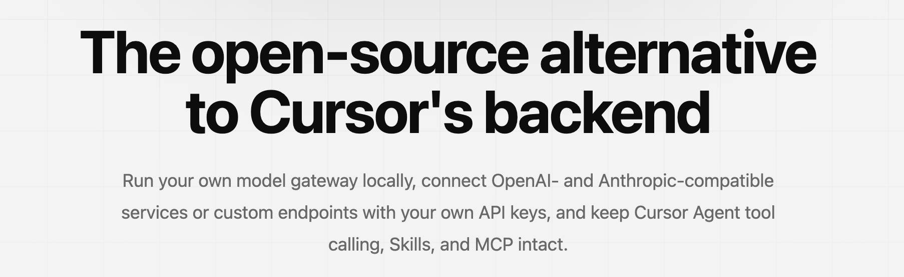
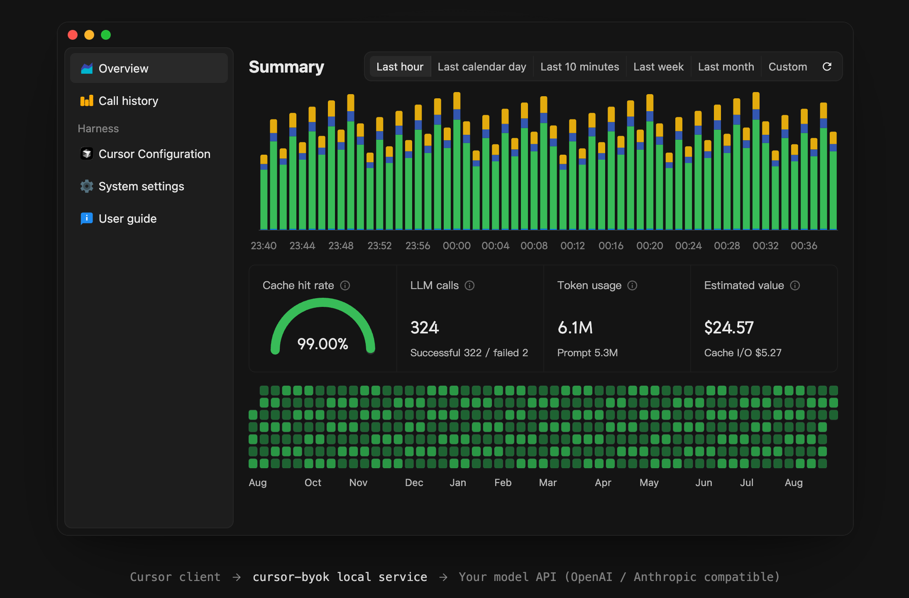
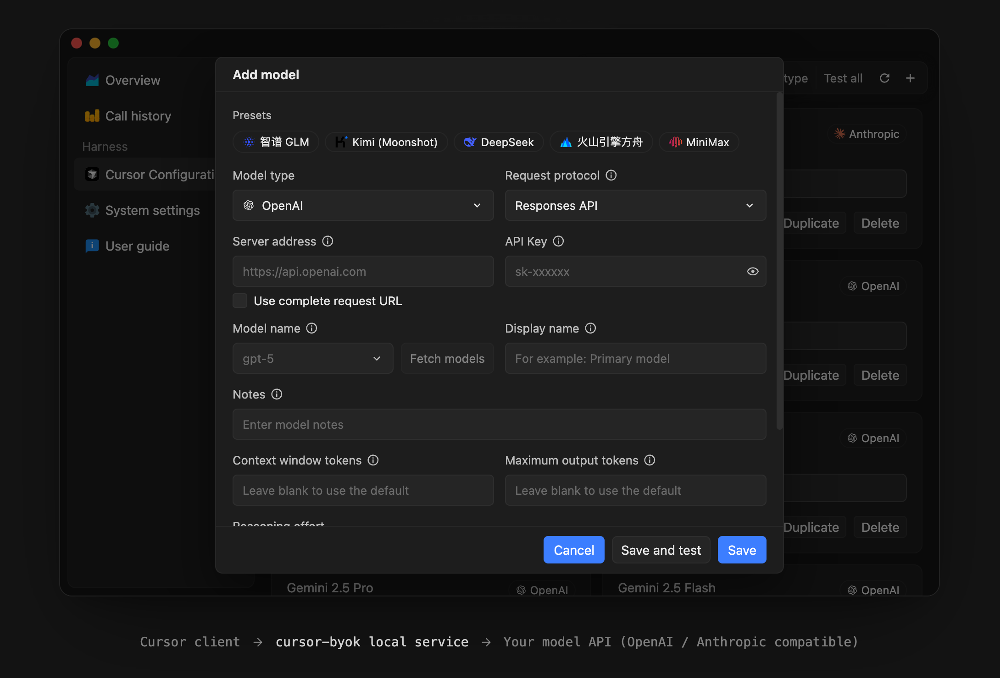

<div align="center">

# cursor-byok

运行在本机的 Cursor 后端：用你自己的模型 API，保留 Agent 工具、Skills 和 MCP。

[English README](./README.md) · [下载](https://github.com/zkldwxz/cursor-byok/releases/latest) · [Telegram](https://t.me/cursor_byok)

[](https://github.com/zkldwxz/cursor-byok/releases/latest)
[](https://github.com/zkldwxz/cursor-byok/releases)
[](./LICENSE)
[](https://github.com/zkldwxz/cursor-byok/releases/latest)

</div>





## 这是什么

**cursor-byok** 在你的电脑上充当 Cursor 的本地后端。Cursor 把 Agent 请求发给本服务，本服务再转发到你配置的 OpenAI / Anthropic 兼容接口。

API Key 和设置只存在本机。模型流量仍会发往你选择的上游。本项目是独立项目，与 Cursor 官方没有关联。

当前维护和发版仓库是 [zkldwxz/cursor-byok](https://github.com/zkldwxz/cursor-byok)。与已归档上游的关系见 [本仓库与上游](#本仓库与上游)。

## 功能

- **自定义模型通道：** 每个模型独立配置地址、凭据、模型 ID、Header 和额外参数。
- **多种协议：** OpenAI Responses、OpenAI Chat Completions、Anthropic Messages。
- **Magpie 供应商：** 一次连接本机网关，自动同步对话模型和路由组。
- **Agent 循环：** 工具调用、Skills、MCP、子代理、多轮对话。
- **本地存储：** SQLite 检查点、启动时清理死血统、单文件设备迁移导出。
- **管理界面：** 模型编辑、连接测试、用量与缓存、插件与系统设置。
- **桌面应用：** macOS / Windows / Linux，更新通道指向本仓库的 GitHub Releases。

## 快速开始

1. 从 [GitHub Releases](https://github.com/zkldwxz/cursor-byok/releases/latest) 下载对应系统的安装包。
2. 打开 cursor-byok → **Cursor 配置**，按提示初始化本地 CA。
3. 在模型设置中添加模型（服务地址、API Key、模型名称），保存并运行 **测试**。
4. 点击 **开启接管Cursor**，保持 cursor-byok 在本机运行。
5. **首次安装或升级 Cursor 后，完全退出并重新启动 Cursor，再新开一个对话**，在模型列表里选你配置的模型，不要选 **Auto**。

配置完成前已经打开的对话不会接到本地后端。

## 模型配置

每个保存的模型就是一条独立的上游通道。



| 模型系列 | 模型类型 | 请求协议 |
| --- | --- | --- |
| Claude 系列 | **Anthropic** | Messages API |
| GPT / OpenAI 系列 | **OpenAI** | **Responses API**（优先；Chat Completions 容易丢掉提示词缓存） |
| 其他模型 | **OpenAI** | **Chat Completions API** |

常用字段：模型类型、请求协议、服务器地址（基础地址或完整 URL）、API Key、上游模型标识、Cursor 里显示的名称、上下文 / 最大输出 Token、推理强度、JSON Header、额外 JSON 参数。只填写服务商文档里有的字段。

如果模型和账号已获上游 Ultrafast 权限，选择 **OpenAI → Responses**，启用额外 JSON 参数并加入 `"service_tier": "ultrafast"`。该模型默认请求 Ultrafast，Cursor 的 **Speed** 菜单可显式切回 Standard 或 Fast。客户端未显式选档时使用这条模型配置。选择档位后 BYOK 会发送 `default`、`priority` 或 `ultrafast`，实际档位以 Responses 的 `service_tier` 回执为准。

在本机启动 Magpie，然后打开 **Cursor → Magpie → 连接 Magpie**，选择启用的模型。应用自动发现网关端口，启动时和每 10 分钟同步一次；手动供应商不受影响。

## 网页搜索服务

内置网页搜索会把查询发送给 [Exa 官方 MCP 服务](https://github.com/exa-labs/exa-mcp-server)，无需账号，查询里勿携带私有工作区内容。匿名访问有限流，额度用完时工具会直接说明，没有其他内置搜索源。Exa 的客户端开源，托管搜索后端不开源。

搜索较多时，可以在 Cursor 的 MCP 设置里添加自己的搜索 MCP，例如登录[自己账号](https://github.com/exa-labs/exa-mcp-server#authentication)的 Exa：

```json
{"mcpServers":{"exa":{"url":"https://mcp.exa.ai/mcp?tools=web_search_exa"}}}
```

其他搜索 MCP 也可以。它与内置搜索并存，不会替换内置搜索。

## 本地 / SSH 工作区搜索

- **SemanticSearch 是内置工具**，各模式都有，不需要安装扩展。它经 Cursor 在代码所在的机器（本机或 SSH 远端）免审批运行一条固定的检索命令；那台机器首次使用时，桌面 BYOK 会把程序和模型送过去并校验，之后直接使用。支持 macOS 和 Linux；Windows 工作区请用 Grep。
- **文本、文件名和读文件**由 Cursor 在工作区执行 Grep / Glob / Read。**按函数名或描述定位代码**使用自研 Rust 索引 `byok-semantic`，**定义、实现和引用**使用当前 Cursor 窗口已加载的语言扩展。两项服务由 [BYOK Workspace Symbols](apps/workspace-symbols/README.md) 为每个受信任的工作区根目录单独注册。
- [BYOK Workspace Symbols](apps/workspace-symbols/README.md) 的 VSIX 已内置全部平台的 `byok-semantic` 二进制，无需 `cargo install`。开启接管后，桌面 BYOK 的 Cursor 页会提示安装或更新扩展，一键完成（也可以把 VSIX 另存到下载目录手动安装）；安装后重载 Cursor 窗口生效，再在 MCP 设置中启用对应目录的 `semantic-…` 和 `symbols-…`。`byok-semantic` 在工作区主机运行本地嵌入和索引；`symbols-…` 直接使用该窗口的语言服务，无需额外安装。SSH 远端：先在本地装好，再在 Cursor 扩展视图对它点 **Install in SSH: …** 把同一个 VSIX 装到远端，远端会自动选中对应平台的二进制。
- **BYOK 和 Magpie 留在桌面机器**。开启接管后，桌面静默启动也会恢复本地代理。SSH 窗口运行 **BYOK: Check Remote Inference Route** 查看该窗口的有效配置；它只报告设置，不证明网络已连通。若为 `auto` / `never`，在 **Remote Settings** 将 `cursorAgentHost.remoteInferenceRoute` 设为 `always`，再用 **Developer: Reload Window** 重载该 SSH 窗口。Cursor 3.31.15 只在 Agent Host 启动时读取此值，私有推理远端会忽略 `always`。不要把远端 `localhost` 填作桌面 Magpie 地址。

### SSH 长对话、内存和磁盘

- 长对话恢复会先用 BYOK 本地已保存的 Blob，缺失的才向 Cursor 请求。每次最多并行恢复 4 个根消息，仍按检查点的顺序交给模型。
- 远端索引优先打开实际仓库目录。可在 Cursor 的索引设置检查纳入索引的文件，用 `.cursorindexingignore` 排除数据集、日志和构建产物。若这些文件也应从 Agent 原生文件工具排除，用 `.cursorignore`。终端和 MCP 仍受实际文件权限约束。[Cursor 排除规则](https://cursor.com/docs/reference/ignore-file)
- `remote.SSH.serverShutdownTimeout` 默认 300 秒，从最后一个客户端断开后开始计时。单人远端可按实际重连频率缩短。`remote.SSH.localServerDownload` 的 `always` 会让桌面下载安装包再传到服务器，`off` 让远端自行下载，`auto` 则在远端下载失败后回到桌面下载。
- 在 Cursor 3.31.15 / Remote SSH 1.1.17 中，Linux/macOS 启动脚本每个架构目录保留最近五项，并跳过正在运行的版本。默认目录以客户端产品配置为准，该版本为 `~/.cursor-server`。如果曾设置 `remote.SSH.serverInstallPath`，也检查旧路径。远端可用 `du -sh ~/.cursor-server/bin/*/* 2>/dev/null` 查看各版本磁盘占用，用 `ps -u "$(id -un)" -o pid,ppid,rss,comm` 查看当前用户进程的 RSS。磁盘目录存在和进程仍占用内存是两项不同的观测。

## TAB 补全

Cursor 的 Tab 补全走独立 TAB 服务，不经过对话模型通道。在 **系统设置 → TAB 设置** 中选择：

- **公益服务（默认）：** 项目提供的公共服务，无需额外配置。
- **直连：** 使用当前登录 Cursor 账号对应的官方 TAB 服务。
- **自定义：** 自建 TAB 服务。最后一版源码在已归档上游：[`cursor-tab-server`](https://github.com/leookun/cursor-byok/tree/archive/v0.0.49/cursor-tab-server)。

改 TAB 模式后请重启 Cursor 并新开对话。

## 与官方账号并存

- 用自己的 Cursor 账号登录。若还停在旧版生成的假账号上，先退出再登录自己的账号。
- 账号有官方额度时，官方模型与本地模型可以混用。
- **Auto 只走官方模型。** 没有官方额度时，请手动选本地模型。
- 插件、代码库索引等 IDE 功能可继续使用。

## 数据流转

```text
Cursor 客户端
    │  Agent 请求、工具结果、KV blob
    ▼
cursor-byok（本机本应用）
    │  OpenAI / Anthropic 兼容 HTTP
    ▼
你配置的模型 API
```

密钥只作为请求头发往该 API，不会上传到本项目的服务器。

## 项目结构

```text
cursor-byok/
├── apps/desktop/          桌面 UI（React）与 Tauri 壳
├── server/                本地 Cursor 后端、存储、插件、管理 API
├── apps/workspace-symbols/ Cursor 工作区符号搜索扩展
├── crates/semble-core/    独立检索基准使用，不参与桌面对话
├── protocols/cursor/      捕获的 Cursor protobuf（唯一来源）
├── support/               协议提取、抓包、基准测试
├── .agents/skills/        各区域贡献规则
└── .github/workflows/     CI 与桌面 GitHub Release
```

独立服务默认将管理后台绑定到 `127.0.0.1:3001`（`CURSOR_CONTROL_ADDR` 只接受回环地址），推理绑定到 `127.0.0.1:3000`（`CURSOR_LISTEN_ADDR`）。推理端口只提供 `/byok/v1/*`；外部 API 默认关闭，启用后须提供访问密钥。Docker 仅公开推理端口。桌面的实际推理地址见「设置 → 外部 API」。

## Rules 怎么引入？

- **项目规则**：放在当前项目的 `.cursor/rules/` 中，用 Cursor 的 Rules 设置管理常驻、按路径匹配和手动规则。也可以用 Cursor 支持的项目 `AGENTS.md`。SSH 项目把规则提交到远端工作区；Cursor 判断本轮该选哪些规则，并随请求交给桌面 BYOK，不需要把同一份项目规则再复制到桌面。
- **个人全局规则**。在 Cursor 的 Rules 中管理，或在桌面 BYOK 机器上创建 `~/.cursor-byok-v3/rules/personal/`，放入纯 Markdown 文件，例如 `language.md`。BYOK 按文件名顺序全局加载这些文件。父目录由 Cursor 规则同步管理，手写规则请放在 `personal/`。带 Git origin 的镜像规则只对匹配的工作区生效。
- **验证**：新开一个 BYOK 对话，用一条无害且可辨认的规则（例如「回答第一行写 RULES_OK」）确认。规则正常变更时，BYOK 在对话尾部追加新的上下文，不改写旧消息；有冲突时新开对话可避开旧历史规则。

## 本地开发

需要 Rust、Node.js / npm，以及 Tauri 2 的系统依赖。

```bash
npm --prefix apps/desktop install
make dev-web          # 后端 + Vite
make dev-desktop      # Tauri
make check            # fmt、clippy、测试、前端检查，与 CI 相同
```

改代码前请读 [AGENTS.md](./AGENTS.md) 和 [`.agents/skills/`](.agents/skills/)。

## 本仓库与上游

cursor-byok 由 [leookun](https://github.com/leookun) 在 [leookun/cursor-byok](https://github.com/leookun/cursor-byok) 创建。该仓库已于 **2026 年 10 月归档**。

**本仓库是后续维护点：** 修复、供应商支持、存储与瘦身、更新签名、GitHub Release 都在 [zkldwxz/cursor-byok](https://github.com/zkldwxz/cursor-byok) 发布。安装包和 `latest.json` / `update.json` 指向这里。

原仓库的 MIT 代码仍是基础。致谢原作者和上游贡献者；本仓库在那棵提交树上继续维护。

## 社区

- [Telegram](https://t.me/cursor_byok)
- QQ 群：`1095916242`、`1094411438`、`1095918002`、`1094419321`

反馈问题时请带上操作系统、cursor-byok 版本、模型类型、协议、已脱敏的服务地址、错误信息和复现步骤。不要粘贴 API Key。

## 许可证

[MIT License](./LICENSE)。Copyright (c) 2026 leookun, zkldwxz。

原仓库贡献者：

<a href="https://github.com/leookun/cursor-byok/graphs/contributors">
  
</a>
