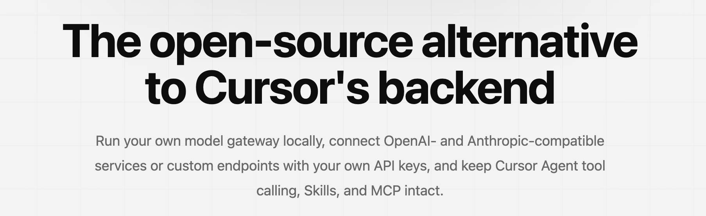
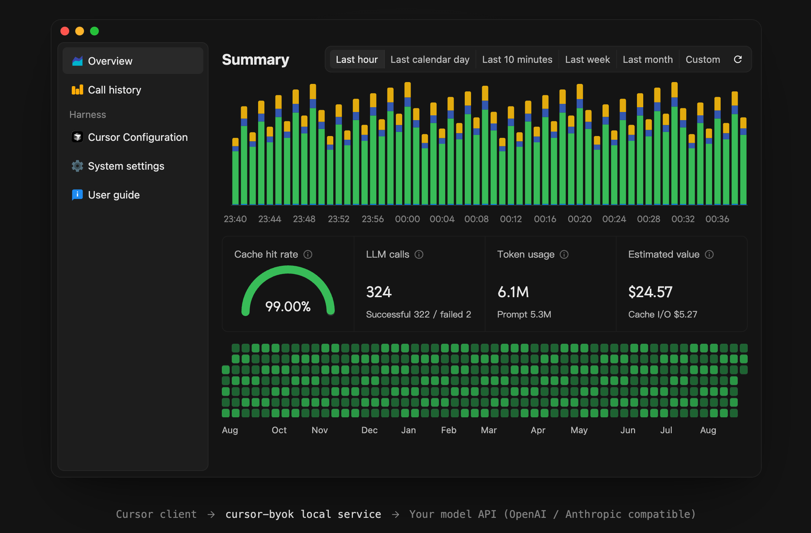
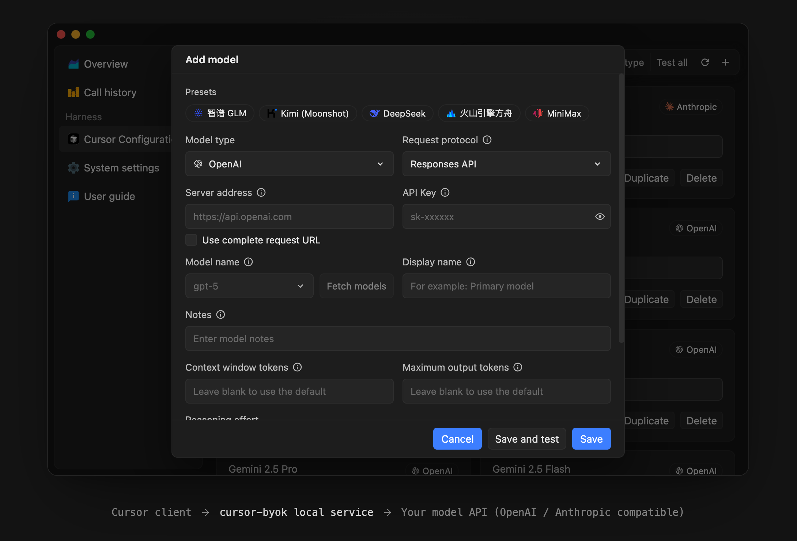

<div align="center">

# cursor-byok

A local backend for Cursor: bring your own model APIs, keep Agent tools, Skills, and MCP.

[中文说明](./README-CN.md) · [Download](https://github.com/zkldwxz/cursor-byok/releases/latest) · [Telegram](https://t.me/cursor_byok)

[](https://github.com/zkldwxz/cursor-byok/releases/latest)
[](https://github.com/zkldwxz/cursor-byok/releases)
[](./LICENSE)
[](https://github.com/zkldwxz/cursor-byok/releases/latest)

</div>





## What this project is

**cursor-byok** runs on your machine as Cursor's local backend. Cursor talks to this service instead of (or alongside) the official cloud; the service forwards model calls to the OpenAI- or Anthropic-compatible APIs you configure.

API keys and settings stay on disk. Model traffic still goes to the provider you chose. This project is independent and is not affiliated with Cursor.

This repository, [zkldwxz/cursor-byok](https://github.com/zkldwxz/cursor-byok), is where the app is maintained and released. See [Origin](#origin) for the archived upstream it continues.

## Features

- **Your model channels:** endpoint, credentials, model ID, headers, and extra parameters per model.
- **Protocols:** OpenAI Responses, OpenAI Chat Completions, Anthropic Messages.
- **Magpie provider:** connect once to your local gateway and follow its chat models and routing groups.
- **Agent loop:** tool calling, Skills, MCP, subagents, and multi-turn history.
- **Local store:** SQLite checkpoints, startup pruning of dead lineages, and a one-file device migration export.
- **Operations UI:** model editor, connection tests, token/cache metrics, plugins, and system settings.
- **Desktop app:** macOS, Windows, and Linux, with in-app updates from this repository's GitHub Releases.

## Quick start

1. Download the latest build for your OS from [GitHub Releases](https://github.com/zkldwxz/cursor-byok/releases/latest).
2. Open cursor-byok → **Cursor**, and initialize the local CA when prompted.
3. Open **Model Settings**, add a model (server URL, API key, model ID), save, and run **Test**.
4. Turn on Cursor takeover and keep cursor-byok running locally.
5. After the first install, or after upgrading Cursor, **quit Cursor completely**, start it again, open a **new** chat, and pick the model you configured — not **Auto**.

Existing chats opened before the first successful connection will not pick up the local backend.

## Model settings

Each saved model is one upstream channel.



| Family | Type | Protocol |
| --- | --- | --- |
| Claude | **Anthropic** | Messages API |
| GPT / OpenAI | **OpenAI** | **Responses API** (preferred; Chat Completions often drops prompt cache) |
| Everything else | **OpenAI** | **Chat Completions API** |

Useful fields: type, protocol, server URL (base or full), API key, upstream model ID, display name shown in Cursor, context / max-output tokens, reasoning effort, JSON headers, and extra JSON body fields. Only send fields the provider documents.

For an upstream model and account with Ultrafast access, select **OpenAI → Responses**, enable extra JSON body fields, and set `"service_tier": "ultrafast"`. This sets the model's default tier. Cursor's **Speed** menu can select Standard or Fast explicitly. Clients that do not select a tier explicitly use the saved model setting. BYOK sends `default`, `priority`, or `ultrafast`, and the Responses `service_tier` reports the tier the provider used.

For Magpie, start the gateway locally, open **Cursor → Magpie → Connect**, then choose which models to enable. The app discovers the loopback port, refreshes the catalog on startup and every ten minutes, and keeps your manual providers unchanged.

## Local and Remote SSH workspace search

Cursor executes Grep, Glob and Read in the workspace. Install [BYOK Workspace Symbols](apps/workspace-symbols/README.md), Semble and Serena on the host that holds the files. Each trusted root registers `semantic-…` for natural-language search and `symbols-…` for definitions, implementations and references. Semble embeds and indexes locally on that host.

Keep BYOK and Magpie on the desktop machine. In an SSH window run **BYOK: Check Remote Inference Route**. If the effective `cursorAgentHost.remoteInferenceRoute` is `auto` or `never`, set it to `always` in Remote Settings and reload that window. In Cursor 3.31.15 private-inference remotes ignore this setting. The command reports configuration, not a live connectivity test.

### SSH conversation recovery, memory and disk usage

- BYOK restores Blob data from its local store first and requests missing roots from Cursor. Up to four roots are restored concurrently. The provider receives them in checkpoint order.
- Open the repository itself as the remote workspace. Review the files in Cursor's indexing settings and use `.cursorindexingignore` for datasets, logs and build output that should stay out of the index. Use `.cursorignore` when Cursor's native Agent tools should skip those files as well. Shell and MCP tools follow the host's file permissions. [Cursor ignore files](https://cursor.com/docs/reference/ignore-file)
- `remote.SSH.serverShutdownTimeout` defaults to 300 seconds after the last client disconnects. For a single-user host, tune it to your reconnect frequency. `remote.SSH.localServerDownload` set to `always` downloads on the desktop and transfers the archive to the remote. `off` downloads on the remote. `auto` uses the desktop when the remote download fails.
- With Cursor 3.31.15 / Remote SSH 1.1.17, the Linux/macOS startup script keeps the five most recent entries per architecture and skips running versions. The product configuration in this release sets the default location to `~/.cursor-server`. Check previous `remote.SSH.serverInstallPath` locations too. On the remote host, use `du -sh ~/.cursor-server/bin/*/* 2>/dev/null` for build disk usage and `ps -u "$(id -un)" -o pid,ppid,rss,comm` for your processes' resident memory.

## Tab completion

Cursor Tab is a separate service; it does not go through your chat model channel. In **System Settings → TAB**:

- **Public service (default):** the shared Tab endpoint, no extra setup.
- **Direct:** the official Tab service for the Cursor account currently signed in.
- **Custom:** a self-hosted Tab server. The last published tree is on the archived upstream: [`cursor-tab-server`](https://github.com/leookun/cursor-byok/tree/archive/v0.0.49/cursor-tab-server).

Restart Cursor and open a new chat after changing Tab mode.

## Official Cursor account

cursor-byok can sit next to a real Cursor login:

- Sign in with your own Cursor account. If an older fake account is still logged in, sign it out first.
- Official models and local models can be mixed when the account has official quota.
- **Auto uses official models only.** With no official quota, pick a local model yourself.
- Indexing, plugins, and other Cursor IDE features keep working.

## Data flow

```text
Cursor desktop
    │  Agent requests, tool results, KV blobs
    ▼
cursor-byok (this app, on your machine)
    │  OpenAI / Anthropic compatible HTTP
    ▼
The model API you configured
```

Keys never leave the local SQLite store except as request headers to that API.

## Project layout

```text
cursor-byok/
├── apps/desktop/          Desktop UI (React) and Tauri shell
├── server/                Local Cursor backend, store, plugins, control API
├── apps/workspace-symbols/ Cursor workspace symbol search extension
├── crates/semble-core/    Standalone benchmark engine, not used by desktop chats
├── protocols/cursor/      Captured Cursor protobuf (single source)
├── support/               Protocol extractor, capture tools, benchmarks
├── .agents/skills/        Area rules for contributors
└── .github/workflows/     CI and desktop GitHub Releases
```

The standalone server binds management to `127.0.0.1:3001` (`CURSOR_CONTROL_ADDR` must be loopback), and inference to `127.0.0.1:3000` (`CURSOR_LISTEN_ADDR`). The inference listener only serves `/byok/v1/*`; the external API is disabled by default and requires a key when enabled. Docker exposes only inference. On desktop, see Settings → External API for the bound address.

## Using rules

- **Project rules:** Put rules in the workspace's `.cursor/rules/` or use `AGENTS.md` where Cursor supports it. For SSH, keep project rules in the remote checkout. Cursor decides which rules apply and supplies them to BYOK as request context.
- **Personal rules:** Manage them in Cursor's Rules settings, or create `~/.cursor-byok-v3/rules/personal/` on the BYOK machine and add plain Markdown files such as `language.md`. BYOK applies these files globally in filename order. Cursor's rule sync manages the parent directory, so keep handwritten rules in `personal/`. Mirrored rules with a Git origin apply only to matching workspace repositories.
- **Verify:** Start a new BYOK conversation with a harmless rule such as “Start the answer with RULES_OK”. Rule changes append updated context rather than rewriting earlier conversation history.

## Development

Need Rust, Node.js / npm, and Tauri 2 system libraries.

```bash
npm --prefix apps/desktop install
make dev-web          # server + Vite
make dev-desktop      # Tauri
make check            # fmt, clippy, tests, frontend check — same as CI
```

See [AGENTS.md](./AGENTS.md) and [`.agents/skills/`](.agents/skills/) before changing an area.

## Origin

cursor-byok was created by [leookun](https://github.com/leookun) in [leookun/cursor-byok](https://github.com/leookun/cursor-byok). That repository was **archived in October 2026**.

**This repository is the continuation:** bug fixes, provider support, store/pruning work, updater signing, and GitHub Releases are published from [zkldwxz/cursor-byok](https://github.com/zkldwxz/cursor-byok). Installers and `latest.json` / `update.json` point here.

The original MIT-licensed code remains the foundation. Credit belongs with the original author and everyone who contributed upstream; this repo adds maintenance on top of that tree.

## Community

- [Telegram](https://t.me/cursor_byok)
- QQ: `1095916242`, `1094411438`, `1095918002`, `1094419321`

When reporting a problem, include OS, cursor-byok version, model type, protocol, a redacted endpoint, the error, and reproduction steps. Do not paste API keys.

## License

[MIT License](./LICENSE). Copyright (c) 2026 leookun, zkldwxz.

Original contributors:

<a href="https://github.com/leookun/cursor-byok/graphs/contributors">
  
</a>
